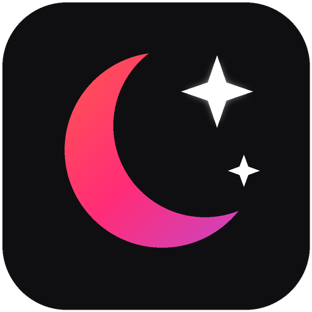

# 🌑 Noir Browser

**Минималистичный чёрный браузер на Electron в духе Chrome/Brave** — с предустановленным блокировщиком рекламы уровня uBlock Origin и встроенным **бесплатным ИИ-агентом**, который управляет браузером по текстовым командам.



## ⬇️ Скачать готовый установщик для Windows

Зайдите в раздел **[Releases](https://github.com/BalaRmack/Walkgame/releases)** и скачайте `Noir Browser Setup <версия>.exe`.

> При первом запуске Windows SmartScreen может показать предупреждение (установщик не подписан платным сертификатом) — нажмите **«Подробнее» → «Выполнить в любом случае»**. Исходный код открыт, собирается публично в GitHub Actions.

## ✨ Возможности

- **Вкладки как в Chrome**: создание/закрытие/переключение, фавиконы, спиннеры загрузки, закрытие средней кнопкой мыши.
- **Адресная строка (омнибокс)**: адреса и поиск в DuckDuckGo; префиксы `g запрос` — Google, `yt запрос` — YouTube.
- **Навигация**: Назад / Вперёд / Обновить (Стоп при загрузке) / Домой, своя стартовая страница с часами и быстрыми ссылками.
- **Чёрный интерфейс**: frameless-окно с кастомной полосой вкладок, глубокий тёмный фон (`#0f0f0f`), фирменный градиент оранжевый → малиновый → фиолетовый в стиле Brave, `nativeTheme.themeSource = 'dark'`. Есть и светлая тема (кнопка-луна), по умолчанию — тёмная.
- **🛡️ Noir Shields — блокировщик рекламы «из коробки»** на движке [@ghostery/adblocker-electron](https://github.com/ghostery/adblocker) (совместим со списками EasyList и правилами uBlock Origin): режет рекламу и трекеры на уровне сети + косметические фильтры. Иконка-щит в адресной строке показывает статус и счётчик заблокированных запросов, там же выключается. Расширения ставить не нужно.
- **🤖 Бесплатный ИИ-агент** (правая панель, кнопка «ИИ», шорткат `Ctrl+Shift+A`): понимает команды на русском и английском и сам выполняет действия в браузере. Работает **офлайн и без API-ключей**.
- **Контекстное меню страницы**: назад/вперёд/обновить, копировать/вставить, «Открыть ссылку в новой вкладке», поиск выделенного.
- **Приватность по умолчанию**: сайты не получают разрешений (камера/микрофон/уведомления запрещены), загрузки падают сразу в папку «Загрузки».
- **Горячие клавиши**: `Ctrl+T` — новая вкладка, `Ctrl+W` — закрыть, `Ctrl+L` — адресная строка, `Ctrl+R` — обновить (работают и когда фокус на странице).

## 🤖 Как пользоваться ИИ-агентом

Нажмите градиентную кнопку **«ИИ»** и пишите команды обычными словами:

| Команда | Что произойдёт |
|---|---|
| `открой YouTube` / `открой example.com` | Агент открывает сайт (понимает «ютуб», «вк», «гитхаб», «википедию» и т.п.) |
| `найди погоду в Москве` | Поиск; `найди на ютубе кошек` — поиск сразу в YouTube |
| `кликни Войти` / `нажми Подписаться` | Находит на странице кнопку/ссылку с этим текстом и нажимает |
| `введи в поиск новости` | Находит поисковое поле, печатает и отправляет |
| `заполни поле Email значением test@mail.ru` | Заполняет конкретное поле формы по его подписи |
| `прокрути вниз` / `в конец` | Скроллит страницу |
| `что на этой странице?` | Читает заголовки и текст страницы и показывает сводку |
| `новая вкладка`, `закрой вкладку`, `назад`, `обнови`, `домой` | Управляет браузером |
| `что ты умеешь?` | Подсказка по командам |

Если агент что-то не нашёл — он честно скажет об этом в чате, а не зависнет. Кнопка **«■ Стоп»** отменяет текущую команду.

### Хотите агента «поумнее»? Подключите бесплатную LLM ⚙️

В панели ИИ нажмите шестерёнку и выберите провайдера (ключ хранится только локально):

- **Встроенные команды** *(по умолчанию)* — бесплатно, офлайн, без ключа.
- **Ollama** — локальная модель на вашем ПК, полностью бесплатно: поставьте [Ollama](https://ollama.com), `ollama pull llama3.1`, адрес по умолчанию `http://localhost:11434`.
- **Groq** — щедрый free tier: бесплатный ключ на [console.groq.com](https://console.groq.com) (модель по умолчанию `llama-3.3-70b-versatile`).
- **OpenRouter** — есть бесплатные модели (`:free`), ключ на [openrouter.ai](https://openrouter.ai).
- **Свой OpenAI-совместимый endpoint** — любой URL вида `.../v1`.

With LLM модель получает «снимок» страницы и составляет JSON-план действий (открыть/кликнуть/ввести/прокрутить/прочитать), который агент выполняет шаг за шагом. Если LLM недоступна — агент автоматически откатывается на встроенный интерпретатор.

> **Почему не `browser-use`?** Это отличная Python-библиотека, но вшивать Python-рантайм + Playwright в Windows-установщик Electron — тяжело и ненадёжно. Noir реализует те же примитивы (navigate/click/type/scroll/extract по снимку страницы) нативно на TypeScript через Electron API — результат тот же, установщик в разы легче.

## 🛡️ Как проверить блокировщик

1. Откройте браузер — щит в адресной строке должен светиться градиентом.
2. Со стартовой страницы нажмите «Проверить на adblock-tester.com» (или просто попросите агента: `открой adblock-tester.com`). Большинство блоков будут заблокированы, счётчик на щите растёт.

Движок один раз скачивает готовые фильтры и кэширует их (`engine.bin` в папке данных приложения), дальше работает мгновенно и офлайн.

## 🚀 Запуск в dev-режиме

Нужен Node.js 20+.

```bash
npm ci        # или npm install
npm start     # соберёт TypeScript и запустит Electron
```

## 📦 Локальная сборка .exe

```bash
npm run dist:win   # результат: release/Noir Browser Setup 1.0.0.exe (NSIS, x64)
```

## ⚙️ CI/CD и релизы

Файл [`.github/workflows/build-release.yml`](.github/workflows/build-release.yml):

- Триггер: пуш тега `v*` ИЛИ ручной запуск из вкладки **Actions** (можно указать тег).
- Ставит зависимости (`npm ci`), проверяет типы и компилирует (`npm run build`).
- Собирает Windows-установщик: `npx electron-builder --win --x64`.
- **Smoke-тест**: запускает собранный `.exe --smoke-test` — браузер стартует, ИИ-агент по команде «открой example.com» открывает сайт, проверяется готовность блокировщика. Релиз публикуется только при успешном тесте.
- Публикует `.exe`, `latest.yml` и blockmap в **GitHub Releases**.

Отдельный секрет `GH_TOKEN` **не нужен**: workflow использует встроенный `GITHUB_TOKEN` с `permissions: contents: write`.

Выпустить новую версию:

```bash
git tag v1.0.1
git push origin v1.0.1
```

## 🗂️ Архитектура

```
src/
├── main/
│   ├── main.ts        # frameless-окно, вкладки (WebContentsView), навигация, меню, загрузки, --smoke-test
│   ├── adblocker.ts   # Ghostery ElectronBlocker: фильтры, кэш движка, счётчик, переключатель
│   └── agent.ts       # ИИ-агент: офлайн-интерпретатор RU/EN + LLM-планировщик, примитивы страницы
├── preload/preload.ts # безопасный IPC-мост window.noir (contextIsolation + sandbox)
├── shared/protocol.d.ts # типы IPC-протокола
└── renderer/          # UI оболочки: вкладки, омнибокс, стартовая страница, ИИ-чат (index.html, styles.css, app.ts)
scripts/
├── copy-assets.mjs    # копирование HTML/CSS ридера в dist/ после tsc
└── make_icon.py       # генератор иконки (PNG+ICO)
build/                 # иконки для electron-builder
.github/workflows/     # CI: сборка .exe и публикация релиза
```

Безопасность: `contextIsolation: true`, `sandbox: true`, `nodeIntegration: false` и в оболочке, и во вкладках; renderer общается с main только через узкий типизированный IPC из preload.

## Стек

Electron 45 · TypeScript 5 · electron-builder 26 (NSIS) · @ghostery/adblocker-electron 2 · GitHub Actions

---

> В репозитории также лежит прежний файл `walk_navigator_pro_fixed.html` (Walkgame) — Noir Browser его не трогает.
